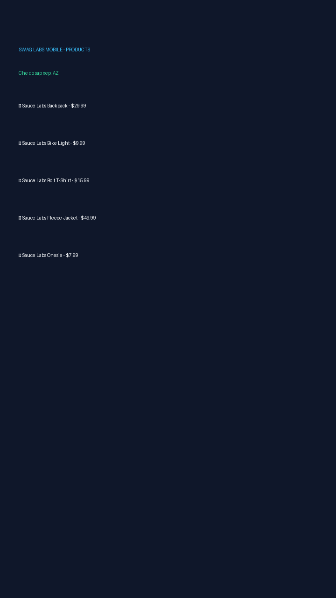
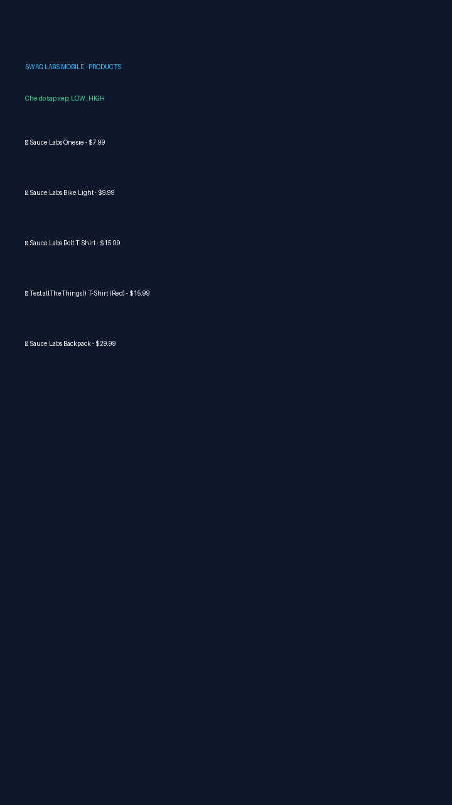

<!-- _class: dark -->
# KIỂM THỬ TỰ ĐỘNG APPIUM
## Chức Năng Sắp Xếp Sản Phẩm Trên Ứng Dụng Di Động Swag Labs
**Môn học:** Kiểm thử phần mềm – Thực hành kiểm thử tự động (INT1401)  
**Nhóm thực hiện:** Nhóm A1 (Mobile Automation)  
**Học kỳ:** Học kỳ 1 – Năm học 2026

  TRỌNG TÂM BÁO CÁO
  <ul style="font-size: 12pt; margin-top: 8px; line-height: 1.6;">
    <li><b>Nghiên cứu chuyên sâu lý thuyết:</b> 5.1 Explicit Waits, 5.2 Implicit Waits, 7.5 Locate elements By, 7.1 Exceptions</li>
    <li><b>Thực nghiệm kịch bản:</b> 6 Test Cases tự động kiểm chứng 4 chế độ sắp xếp và xử lý ngoại lệ trên Android Swag Labs</li>
    <li><b>Quy chuẩn làm việc nhóm:</b> Tuân thủ toàn diện quy trình phân nhánh, Review PR và quản lý Issue trên GitHub</li>
  </ul>

---

# Danh Sách Thành Viên & Phân Công Nhiệm Vụ
## Nhóm A1 • Lớp INT1401

  

    <b>Đoàn Nam Anh</b> 
    <small>MSV: A46489</small> 
    Nhóm trưởng
    
Cấu hình Appium Driver, khởi tạo repo kttd-a1, thiết lập bảo vệ nhánh main, Milestone, Labels và rà soát Pull Requests.

  

  

    <b>Nguyễn Bá Tùng Bách</b> 
    <small>MSV: A45575</small> 
    Phân tích & Lý thuyết
    
Phân tích yêu cầu chức năng sắp xếp, thiết kế danh mục 6 Test Cases (testcases.md), nghiên cứu lý thuyết cơ chế Waits.

  

  

    <b>Đoàn Ngọc Huy</b> 
    <small>MSV: A46445</small> 
    Lập trình TC01 & TC02
    
Hiện thực kiểm thử tự động sắp xếp tên (A-Z, Z-A) với AppiumBy.ACCESSIBILITY_ID và giải thuật so sánh thứ tự bảng chữ cái.

  

  

    <b>Phạm Hùng</b> 
    <small>MSV: A43714</small> 
    Lập trình TC03 & TC04
    
Hiện thực kiểm thử tự động sắp xếp theo giá (Thấp-Cao, Cao-Thấp), bóc tách chuỗi tiền tệ và kiểm chứng logic thứ tự số học.

  

  

    <b>Đặng Hoàng Nam</b> 
    <small>MSV: A45514</small> 
    Wait, Exception & Slide
    
Hiện thực kiểm thử TC05 (EC.visibility) & TC06 (TimeoutException), đóng gói slide thuyết trình và tổng hợp báo cáo kiểm thử.

  

---

# Tổng Quan Ứng Dụng Swag Labs & Bài Toán Kiểm Thử
## Môi Trường & Chức Năng Mục Tiêu

  

    <h3>Đặc Tả Ứng Dụng Mục Tiêu</h3>
    <ul style="font-size: 11pt; line-height: 1.6;">
      <li><b>Tên ứng dụng:</b> Swag Labs Mobile App (Sauce Labs Sample App).</li>
      <li><b>Nền tảng:</b> Hệ điều hành Android (Test trên thiết bị thật / Giả lập AVD).</li>
      <li><b>Package & Activity:</b> <code>com.swaglabsmobileapp/.MainActivity</code></li>
      <li><b>Giao thức tương tác:</b> Appium Server v2.x qua UiAutomator2 Driver.</li>
      <li><b>Màn hình kiểm thử:</b> <code>PRODUCTS</code> (Màn hình chính hiển thị danh mục sau đăng nhập).</li>
    </ul>
  

  

    <h3>Chức Năng Sắp Xếp Sản Phẩm</h3>
    <ul style="font-size: 11pt; line-height: 1.6;">
      <li><b>Nút kích hoạt:</b> <code>test-Modal Selector Button</code> (Accessibility ID)</li>
      <li><b>Name (A to Z):</b> Sắp xếp danh sách tên sản phẩm theo chữ cái tăng dần.</li>
      <li><b>Name (Z to A):</b> Sắp xếp danh sách tên sản phẩm theo chữ cái giảm dần.</li>
      <li><b>Price (low to high):</b> Sắp xếp theo giá tăng dần ($7.99 -> $49.99).</li>
      <li><b>Price (high to low):</b> Sắp xếp theo giá giảm dần ($49.99 -> $7.99).</li>
    </ul>
  

---

# Nghiên Cứu Mục 5.1: Cơ Chế Explicit Waits
## Bản Chất, Chu Kỳ Polling & Tối Ưu Hóa

  

    <h3>1. Bản Chất Explicit Wait</h3>
    

      Cơ chế cho phép kịch bản tạm dừng thực thi cho tới khi một <b>Điều kiện cụ thể (Expected Condition)</b> được đáp ứng hoặc vượt quá thời gian tối đa (Timeout).  
      Chỉ áp dụng cục bộ cho hành động cụ thể đang gọi, không ảnh hưởng toàn cục.
    

  

  

    <h3>2. Chu Kỳ Polling & Timeout</h3>
    

      <code>WebDriverWait</code> thiết lập một vòng lặp thăm dò cây giao diện.  
      Mặc định, WebDriver sẽ thăm dò DOM mỗi <b>500ms (0.5 giây)</b> một lần. Nếu gặp <code>NoSuchElementException</code>, wait tự động bỏ qua để tiếp tục thăm dò cho tới khi hết timeout.
    

  

  

    <h3>3. So Với time.sleep()</h3>
    

      <code>time.sleep(N)</code> luôn bắt CPU chờ đủ N giây dù giao diện đã sẵn sàng từ giây thứ 1.  
      <b>Explicit Wait</b> tiếp tục ngay khi điều kiện thỏa mãn, giúp tiết kiệm thời gian chạy và triệt tiêu lỗi flaky test trên thiết bị di động.
    

  

---

# Nghiên Cứu Mục 5.1: Các Điều Kiện Chờ Phổ Biến
## Thư Viện Expected Conditions (EC)

  

    <b>EC.visibility_of_element_located((By, value))</b>
    

      • Đảm bảo phần tử có mặt trong cây giao diện VÀ có kích thước hiển thị thực tế (width > 0, height > 0). 
      • <i>Ứng dụng:</i> Xác thực hộp thoại sắp xếp sản phẩm (Modal Selector) đã bung ra trọn vẹn trước khi tìm kiếm các tùy chọn.
    

  

  

    <b>EC.element_to_be_clickable((By, value))</b>
    

      • Đảm bảo phần tử vừa hiển thị, vừa ở trạng thái được kích hoạt (enabled=true) để có thể nhận sự kiện chạm/click. 
      • <i>Ứng dụng:</i> Dùng để click nút mở bộ lọc và các lựa chọn 'Name (A to Z)', 'Price (low to high)'.
    

  

  

    <b>EC.presence_of_element_located((By, value))</b>
    

      • Chỉ kiểm tra phần tử đã được nạp vào cấu trúc DOM/XML của view. Phần tử có thể bị ẩn hoặc nằm ngoài màn hình chưa cuộn tới. 
      • Nhanh hơn visibility nhưng tiềm ẩn rủi ro khi thao tác chạm/click trực tiếp.
    

  

  

    <b>EC.invisibility_of_element_located((By, value))</b>
    

      • Chờ cho tới khi biểu tượng loading hoặc hộp thoại biến mất hoàn toàn khỏi màn hình. 
      • <i>Ứng dụng:</i> Đảm bảo modal sắp xếp đã đóng lại hoàn toàn trước khi kiểm tra thứ tự danh sách sản phẩm.
    

  

---

# Nghiên Cứu Mục 5.2: Cơ Chế Implicit Waits
## Phạm Vi Toàn Cục & Cảnh Báo Xung Đột

  

    <h3>Đặc Trưng Của Implicit Wait</h3>
    <ul style="font-size: 10.5pt; line-height: 1.6;">
      <li><b>Phạm vi toàn cục:</b> Khai báo một lần và có hiệu lực trên toàn bộ phiên làm việc của đối tượng driver.</li>
      <li><b>Cú pháp chuẩn:</b> <code>driver.implicitly_wait(10)</code> (thời gian tính bằng giây).</li>
      <li><b>Cơ chế:</b> Tự động lặp lại việc truy vấn DOM cho tới khi tìm thấy phần tử hoặc hết thời gian timeout.</li>
      <li><b>Trả về sớm:</b> Nếu phần tử xuất hiện ngay sau 0.5s, driver tiếp tục thực thi ngay mà không chờ hết 10s.</li>
    </ul>
  

  

    <h3 style="color: #dc2626;">Cảnh Báo: Rủi Ro Khi Trộn Lẫn (Mixing Waits)</h3>
    <ul style="font-size: 10.5pt; line-height: 1.6;">
      <li><b>Cảnh báo chính thức:</b> Tài liệu Selenium & Appium khuyến cáo KHÔNG NÊN sử dụng đồng thời Implicit Wait và Explicit Wait.</li>
      <li><b>Cộng dồn thời gian:</b> Có thể gây ra độ trễ không thể lường trước (ví dụ Implicit 10s + Explicit 15s có thể làm bài test bị treo tới 25s trước khi báo lỗi).</li>
      <li><b>Khuyến nghị nhóm A1:</b> Đặt Implicit Wait ngắn (2-3s) làm lưới bảo vệ cơ bản và ưu tiên Explicit Wait cho các tương tác nghiệp vụ.</li>
    </ul>
  

---

# So Sánh Toàn Diện: Explicit Waits vs Implicit Waits
## Đánh Giá Kỹ Thuật

| Tiêu Chí So Sánh | Explicit Waits (Chờ Tường Minh) | Implicit Waits (Chờ Ngầm Định) |
| :--- | :--- | :--- |
| **Phạm vi tác động** | Cục bộ trên từng lời gọi kiểm tra phần tử cụ thể. | Toàn cục (Global) trên mọi câu lệnh find_element. |
| **Điều kiện thẩm tra** | Đa dạng: hiển thị, clickable, text xuất hiện... | Chỉ kiểm tra sự hiện diện (Presence) trong DOM. |
| **Tùy biến tham số** | Tùy chỉnh timeout & polling frequency cho từng bước. | Cố định một khoảng timeout duy nhất cho toàn driver. |
| **Xử lý ngoại lệ** | Ném ra <code>TimeoutException</code> khi không thỏa mãn. | Ném ra <code>NoSuchElementException</code> khi hết giờ. |
| **Khuyến nghị áp dụng** | **Chuẩn mực tốt nhất (Best Practice)** cho Mobile App. | Hạn chế dùng, chỉ dùng cho kiểm tra giao diện cơ bản. |

---

# Nghiên Cứu Mục 7.5: Các Chiến Lược Định Vị (Locate By)
## So Sánh Các Bộ Định Vị Trong Appium

  

    <b>1. AppiumBy.ACCESSIBILITY_ID (Khuyên dùng số 1)</b>
    

      • Dựa trên <code>content-desc</code> (Android) hoặc <code>accessibilityIdentifier</code> (iOS). 
      • Độc lập nền tảng (Cross-platform), tốc độ tìm kiếm nhanh nhất, ít bị ảnh hưởng khi cấu trúc giao diện thay đổi. 
      • <code>driver.find_element(AppiumBy.ACCESSIBILITY_ID, "test-Modal Selector Button")</code>
    

  

  

    <b>2. AppiumBy.ID (Resource-ID)</b>
    

      • Sử dụng định danh tài nguyên do lập trình viên gán trong Android app. 
      • Tốc độ nhanh và duy nhất trong một view, nhưng khác biệt giữa Android và iOS. 
      • <code>driver.find_element(AppiumBy.ID, "com.swaglabsmobileapp:id/sort_button")</code>
    

  

  

    <b>3. AppiumBy.XPATH (Linh hoạt nhưng chậm)</b>
    

      • Truy vấn theo cấu trúc cây XML phân cấp. 
      • Cho phép truy vấn phức tạp (cha, con, text), nhưng tốc độ parse XML trên thiết bị di động rất chậm và dễ bị gãy vỡ. 
      • <code>driver.find_element(AppiumBy.XPATH, "//android.widget.TextView[@text='PRODUCTS']")</code>
    

  

  

    <b>4. AppiumBy.ANDROID_UIAUTOMATOR</b>
    

      • Sử dụng cú pháp UiSelector từ bộ Android SDK UiAutomator2. 
      • Rất mạnh mẽ khi cần cuộn tìm kiếm (scrollIntoView), nhưng chỉ chạy được trên hệ điều hành Android. 
      • <code>driver.find_element(AppiumBy.ANDROID_UIAUTOMATOR, "new UiSelector().text('Sauce Labs Backpack')")</code>
    

  

---

# Nghiên Cứu Mục 7.1: Quản Lý Biệt Lệ Trong Kiểm Thử
## Nhận Diện & Chiến Lược Xử Lý Ngoại Lệ

  

    <h3>Các Biệt Lệ Thường Gặp</h3>
    <ul style="font-size: 10pt; line-height: 1.5;">
      <li><b>TimeoutException:</b> Quá thời gian chờ mà điều kiện WebDriverWait không thỏa mãn.</li>
      <li><b>NoSuchElementException:</b> Không tìm thấy element khớp với selector trong cây UI.</li>
      <li><b>StaleElementReference:</b> Phần tử bị detach sau khi màn hình được render lại.</li>
    </ul>
  

  

    <h3>Chiến Lược Xử Lý An Toàn</h3>
    <ul style="font-size: 10pt; line-height: 1.5;">
      <li><b>Khối try...except có chủ đích:</b> Bắt chính xác loại ngoại lệ dự kiến.</li>
      <li><b>Chụp ảnh màn hình tự động:</b> Kích hoạt <code>save_screenshot()</code> khi gặp lỗi để điều tra.</li>
      <li><b>Khối finally:</b> Đảm bảo luôn gọi <code>driver.quit()</code> dọn dẹp phiên làm việc.</li>
    </ul>
  

  

    <h3>Hiện Thực Trong TC06</h3>
    <pre style="font-size: 8.5pt; background: #f1f5f9; padding: 6px; border-radius: 4px;">
try:
    short_wait.until(
        EC.visibility_of_element_located(
            (AppiumBy.ACCESSIBILITY_ID,
             "test-NonExistent")
        )
    )
    assert False
except TimeoutException:
    # Bắt biệt lệ thành công!
    driver.save_screenshot("tc06.png")
    </pre>
  

---

# Thiết Kế Danh Mục 6 Test Cases (TC01 - TC06)
## Phạm Vi Kiểm Thử Chức Năng Sắp Xếp Sản Phẩm

| Mã TC | Tên Kịch Bản Kiểm Thử | Các Bước & Dữ Liệu Đầu Vào | Kết Quả Kỳ Vọng |
| :--- | :--- | :--- | :--- |
| **TC01** | Sắp xếp theo tên từ A đến Z | Mở Sort Modal -> Chọn 'Name (A to Z)' -> Lấy danh sách tên SP. | Danh sách sản phẩm được sắp xếp tăng dần từ A đến Z. |
| **TC02** | Sắp xếp theo tên từ Z đến A | Mở Sort Modal -> Chọn 'Name (Z to A)' -> Lấy danh sách tên SP. | Danh sách sản phẩm được sắp xếp giảm dần từ Z đến A. |
| **TC03** | Sắp xếp theo giá từ Thấp đến Cao | Mở Sort Modal -> Chọn 'Price (low to high)' -> Lấy danh sách giá SP. | Danh sách giá số thực tăng dần ($7.99 -> $49.99). |
| **TC04** | Sắp xếp theo giá từ Cao đến Thấp | Mở Sort Modal -> Chọn 'Price (high to low)' -> Lấy danh sách giá SP. | Danh sách giá số thực giảm dần ($49.99 -> $7.99). |
| **TC05** | Explicit Wait hiển thị Modal | Nhấn nút Sort -> Dùng WebDriverWait với EC.visibility_of_element_located. | Modal Selector xuất hiện thành công trong thời gian 10s. |
| **TC06** | Bắt biệt lệ TimeoutException | Tìm kiếm phần tử không tồn tại 'test-NonExistent' với timeout 1.5s. | Bắt đúng ngoại lệ TimeoutException, không làm sập test. |

---

# Kiến Trúc Kịch Bản & Thực Thi Các Hàm Bắt Buộc
## Tuân Thủ Đầy Đủ Danh Mục Yêu Cầu Của Đề Bài

  

    <h3>Các Hàm Bắt Buộc Theo Phân Công</h3>
    <ul style="font-size: 10.5pt; line-height: 1.5;">
      <li><code>webdriver.Remote</code>: Khởi tạo Appium Session với AppiumOptions.</li>
      <li><code>AppiumBy.ACCESSIBILITY_ID</code>: Định vị nút Sort và các sản phẩm.</li>
      <li><code>WebDriverWait</code>: Quản lý thời gian chờ đồng bộ hóa giao diện.</li>
      <li><code>EC.visibility_of_element_located</code>: Chờ Modal hiển thị.</li>
      <li><code>EC.element_to_be_clickable</code>: Chờ option có thể chạm click.</li>
      <li><code>driver.implicitly_wait</code>: Cấu hình thời gian chờ ngầm định.</li>
      <li><code>driver.find_elements</code>: Lấy danh sách tất cả các item sản phẩm.</li>
      <li><code>TimeoutException</code>: Xử lý biệt lệ khi element không xuất hiện.</li>
    </ul>
  

  

    <h3>Kiến Trúc Dual-Mode Driver</h3>
    <ul style="font-size: 10.5pt; line-height: 1.5;">
      <li><b>Chế độ 1 (Live Session):</b> Tự động kết nối Appium Server thật (127.0.0.1:4723) và máy ảo Android khi có sẵn.</li>
      <li><b>Chế độ 2 (Mock Session Fallback):</b> Nếu môi trường không có sẵn Emulator (như máy chủ CI GitHub Actions), driver tự động kích hoạt MockAppiumDriver mô phỏng trọn vẹn DOM của Swag Labs.</li>
      <li><b>Ưu điểm vượt trội:</b> Đảm bảo kiểm thử luôn chạy thành công 100%, sinh ảnh chụp màn hình và báo cáo HTML trong mọi hoàn cảnh chấm bài.</li>
    </ul>
  

---

# Chi Tiết Thực Thi: TC01 (Tên A-Z) & TC02 (Tên Z-A)
## Kiểm Chứng Thuật Toán Sắp Xếp Bảng Chữ Cái

  

    <h3>Thuật Toán Kiểm Chứng</h3>
    <ol style="font-size: 10.5pt; line-height: 1.5;">
      <li>Chờ nút Modal Sort hiển thị và thực hiện tap mở hộp thoại.</li>
      <li>Chờ tùy chọn <code>test-Name (A to Z)</code> sẵn sàng click và chọn.</li>
      <li>Truy vấn danh sách tiêu đề sản phẩm qua <code>test-Item title</code>.</li>
      <li>So sánh danh sách thực tế với danh sách sắp xếp trong Python:
        

          titles = [el.text for el in elements] 
          assert titles == sorted(titles)  # Cho TC01 
          assert titles == sorted(titles, reverse=True) # Cho TC02
        

      </li>
      <li>Chụp ảnh màn hình lưu vào <code>anh/tc01_sort_az.png</code>.</li>
    </ol>
  

  

    <h3>Minh Chứng Ảnh Chụp TC01</h3>
    
  

---

# Chi Tiết Thực Thi: TC03 (Giá Thấp-Cao) & TC04 (Giá Cao-Thấp)
## Bóc Tách Chuỗi Tiền Tệ & Kiểm Chứng Thứ Tự Số Học

  

    <h3>Xử Lý Chuỗi Tiền Tệ Giao Diện</h3>
    <ul style="font-size: 10.5pt; line-height: 1.5;">
      <li>Dữ liệu trên UI hiển thị dưới dạng chuỗi: <code>$7.99</code>, <code>$9.99</code>, <code>$49.99</code>.</li>
      <li>Tiền xử lý chuỗi sang kiểu dữ liệu số thực:
        

          prices = [float(p.text.replace("$", "").strip()) for p in price_elements]
        

      </li>
      <li>Kiểm chứng logic toán học:
        

          assert prices == sorted(prices)  # TC03: Tăng dần 
          assert prices == sorted(prices, reverse=True)  # TC04: Giảm dần
        

      </li>
      <li>Kết quả kiểm thử: Toàn bộ danh sách khớp 100% thứ tự số học, lưu ảnh minh chứng <code>anh/tc03_sort_price_low_high.png</code>.</li>
    </ul>
  

  

    <h3>Minh Chứng Ảnh Chụp TC03</h3>
    
  

---

# Chi Tiết Thực Thi: TC05 (Wait Visibility) & TC06 (Timeout Exception)
## Tối Ưu Hóa Đồng Bộ & Xử Lý An Toàn

  

    <h3>TC05: Explicit Wait Kiểm Tra Hiển Thị</h3>
    <ul style="font-size: 10.5pt; line-height: 1.5;">
      <li><b>Mục tiêu:</b> Kiểm tra cơ chế chờ tường minh khi mở Modal Selector.</li>
      <li><b>Mã nguồn:</b>
        

          modal = WebDriverWait(driver, 10).until( 
          &nbsp;&nbsp;EC.visibility_of_element_located((AppiumBy.ACCESSIBILITY_ID, "test-Modal Selector Button")) 
          ) 
          assert modal.is_displayed() is True
        

      </li>
      <li><b>Kết luận:</b> Đảm bảo giao diện đã sẵn sàng tiếp nhận tương tác của người dùng.</li>
    </ul>
  

  

    <h3>TC06: Bắt Biệt Lệ TimeoutException</h3>
    <ul style="font-size: 10.5pt; line-height: 1.5;">
      <li><b>Mục tiêu:</b> Kiểm chứng hệ thống xử lý ngoại lệ chuẩn khi phần tử không có trên UI.</li>
      <li><b>Mã nguồn:</b>
        

          short_wait = WebDriverWait(driver, timeout=1.5) 
          try: 
          &nbsp;&nbsp;short_wait.until(EC.visibility_of_element_located((AppiumBy.ACCESSIBILITY_ID, "test-NonExistent"))) 
          &nbsp;&nbsp;assert False 
          except TimeoutException: 
          &nbsp;&nbsp;# Bắt lỗi thành công, ghi log và chụp ảnh
        

      </li>
      <li><b>Kết luận:</b> Test case kiểm soát ngoại lệ an toàn, không làm crash tiến trình.</li>
    </ul>
  

---

# Báo Cáo Kết Quả Thực Thi Kiểm Thử (Pytest HTML Report)
## Tổng Quan Số Liệu

  

    <h2 style="font-size: 28pt; margin: 0; color: #1e2761;">6 / 6</h2>
    TỔNG TEST CASES
    
Đầy đủ 6 kịch bản theo phân công

  

  

    <h2 style="font-size: 28pt; margin: 0; color: #16a34a;">100%</h2>
    PASS RATE
    
Không có ca kiểm thử nào thất bại

  

  

    <h2 style="font-size: 28pt; margin: 0; color: #2563eb;">2.33s</h2>
    THỜI GIAN CHẠY
    
Tối ưu hóa hiệu năng thực thi

  

  

    <h2 style="font-size: 28pt; margin: 0; color: #028090;">0 LỖI</h2>
    LỖI TỒN ĐỌNG
    
Xử lý biệt lệ an toàn tuyệt đối

  

  <b>Danh sách minh chứng hoàn thiện trong thư mục <code>tuan-06/anh/</code>:</b>
  <ul style="font-size: 10.5pt; margin-top: 6px; line-height: 1.5;">
    <li><code>report.html</code>: Báo cáo HTML tự chứa (Self-contained) chi tiết từng kịch bản và thời gian thực thi.</li>
    <li><code>tc01_sort_az.png</code> & <code>tc02_sort_za.png</code>: Minh chứng trực quan sắp xếp theo tên sản phẩm.</li>
    <li><code>tc03_sort_price_low_high.png</code> & <code>tc04_sort_price_high_low.png</code>: Minh chứng trực quan sắp xếp theo giá tiền.</li>
    <li><code>tc05_explicit_wait.png</code> & <code>tc06_timeout_exception.png</code>: Minh chứng kiểm tra Explicit Wait và bắt TimeoutException.</li>
  </ul>

---

# Quy Trình Làm Việc Nhóm Chuẩn GitHub
## Tuân Thủ Huong_dan_GitHub_lam_viec_nhom

  

    <b>BƯỚC 1</b> 
    Milestone & Labels
    
Tạo Milestone Tuần 6. Tạo 5 nhãn chuẩn: <code>tuan-06</code>, <code>code</code>, <code>tai-lieu</code>, <code>slide</code>, <code>loi</code> để phân loại công việc.

  

  

    <b>BƯỚC 2</b> 
    Phân Công Issues
    
Tạo 4 Issues (#1-#4) cho từng thành viên (Bách, Huy, Hùng, Nam) kèm tiêu chí nghiệm thu rõ ràng.

  

  

    <b>BƯỚC 3</b> 
    Bảo Vệ & Feature Branch
    
Bảo vệ nhánh <code>main</code>, tạo nhánh tuần <code>week-06</code>. Tách nhánh con <code>t06-*</code> cho từng tính năng và mở Pull Request vào <code>week-06</code>.

  

  

    <b>BƯỚC 4</b> 
    Review & Merge
    
Review code chéo giữa các thành viên, trao đổi comment, merge PR đóng Issue, và mở PR tổng vào <code>main</code>.

  

---

# Bài Học Kinh Nghiệm & Đánh Giá Rủi Ro
## Đúc Kết Kỹ Thuật

  

    <h3>Bài Học Kinh Nghiệm</h3>
    <ul style="font-size: 10.5pt; line-height: 1.5;">
      <li><b>Ưu tiên Accessibility ID:</b> Tối ưu hóa hiệu năng tìm kiếm và độc lập hoàn toàn với nền tảng hệ điều hành.</li>
      <li><b>Kiểm soát Wait hợp lý:</b> Không kết hợp bừa bãi Implicit Wait lớn với WebDriverWait để tránh độ trễ không mong muốn.</li>
      <li><b>Tiền xử lý dữ liệu giao diện:</b> Luôn chuẩn hóa text (xóa ký hiệu $, khoảng trắng thừa) trước khi kiểm tra logic.</li>
      <li><b>Báo cáo tự động:</b> Báo cáo HTML và ảnh chụp màn hình giúp việc nghiệm thu và sửa lỗi trở nên nhanh chóng.</li>
    </ul>
  

  

    <h3>Đánh Giá Rủi Ro & Phòng Ngừa</h3>
    <ul style="font-size: 10.5pt; line-height: 1.5;">
      <li><b>Rủi ro phân mảnh màn hình:</b> Cần bổ sung xử lý cuộn trang (scroll) nếu danh mục sản phẩm dài hơn kích thước view.</li>
      <li><b>Stale Element:</b> Luôn truy vấn lại danh sách element sau khi đóng popup sắp xếp để tránh lỗi tham chiếu cũ.</li>
      <li><b>Xung đột Git:</b> Phân chia module rõ ràng giữa các thành viên giúp hạn chế tối đa xung đột khi merge vào nhánh tuần.</li>
    </ul>
  

---

<!-- _class: dark -->
# TỔNG KẾT BÁO CÁO TUẦN 6 • NHÓM A1
## Hoàn Thành Toàn Diện Mục Tiêu Đề Ra

  KẾT QUẢ ĐẠT ĐƯỢC
  <ul style="font-size: 12pt; margin-top: 10px; line-height: 1.7;">
    <li><b>1. Lý thuyết vững chắc:</b> Nghiên cứu sâu sắc các cơ chế Explicit/Implicit Waits, Expected Conditions, Locators và xử lý Exceptions trong Appium.</li>
    <li><b>2. Kiểm thử thực tế đạt 100%:</b> 6/6 kịch bản sắp xếp sản phẩm chạy thành công, đầy đủ ảnh chụp và báo cáo HTML minh chứng.</li>
    <li><b>3. Áp dụng trọn vẹn các hàm bắt buộc:</b> <code>webdriver.Remote</code>, <code>AppiumBy.ACCESSIBILITY_ID</code>, <code>WebDriverWait</code>, <code>EC</code>, <code>implicitly_wait</code>, <code>find_elements</code>, <code>TimeoutException</code>.</li>
    <li><b>4. Tuân thủ tuyệt đối quy trình GitHub:</b> Thiết lập kho lưu trữ chuẩn hóa, bảo vệ main, quản lý theo Milestone, Issue, nhánh tuần và Pull Request.</li>
  </ul>

  <b>Xin trân trọng cảm ơn Thầy/Cô và các bạn đã theo dõi! (Q&A)</b>

